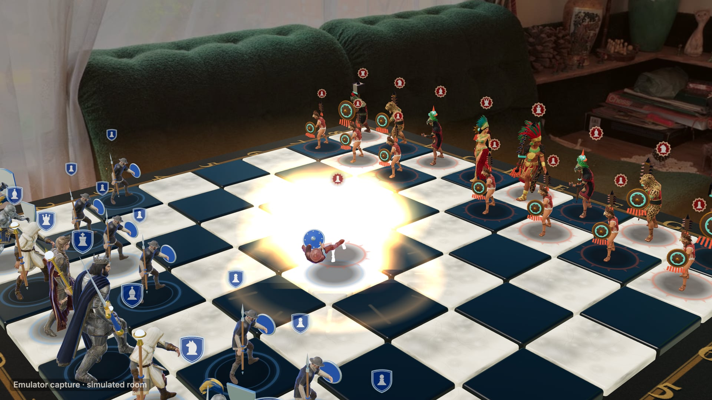
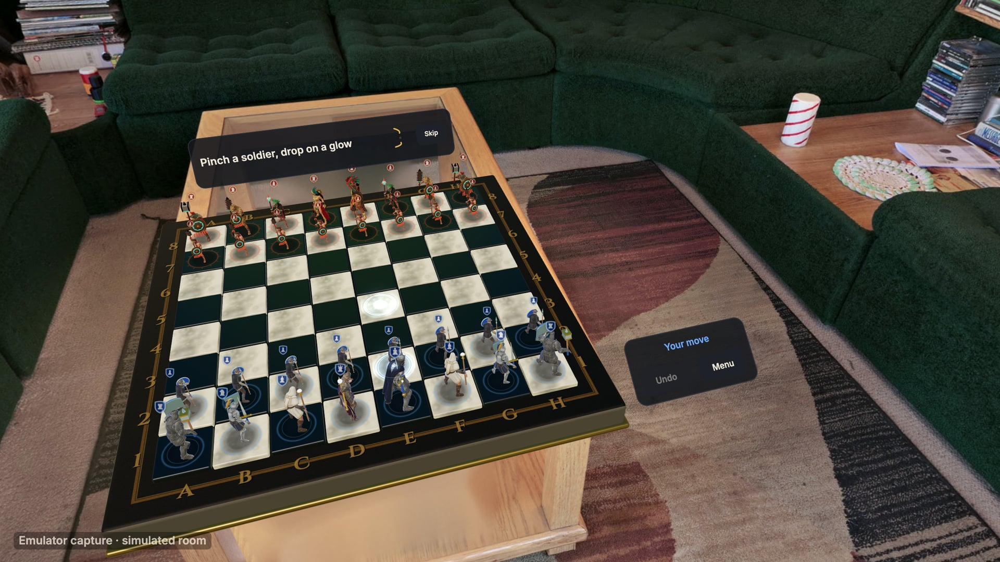
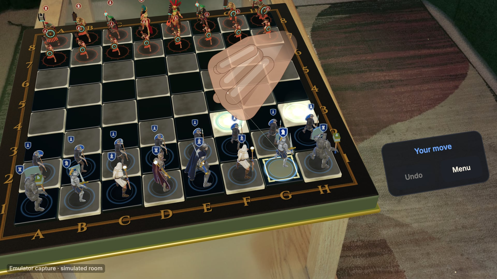
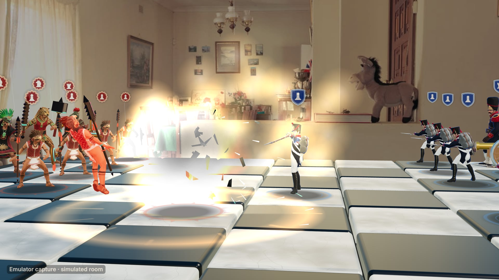
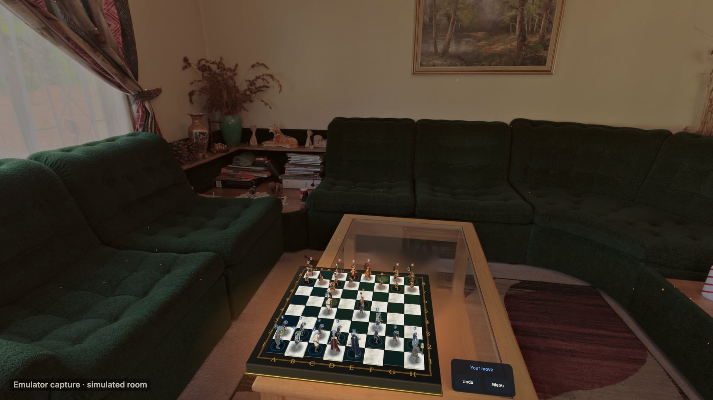
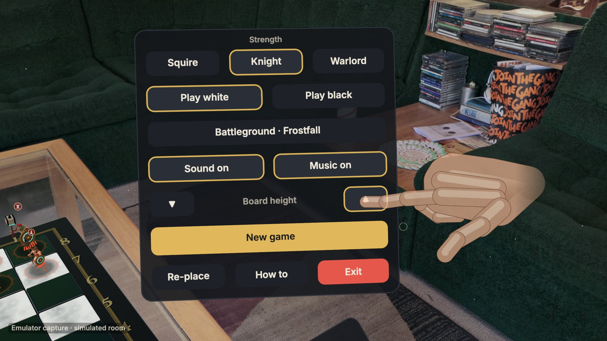
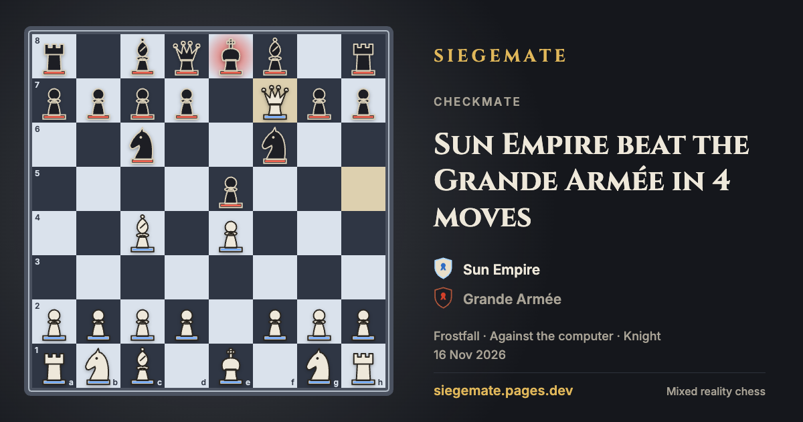

# Siegemate

Siegemate puts two living armies on your real table. In the Meta Quest browser, sculpted soldiers of the Ivory Kingdom, the Sun Empire or Napoleon's Grande Armée stand on the wood in passthrough, breathing and shifting their weight while they wait for orders. Pinch one, carry its glowing order line to a lit square and let go: it marches there on its own legs, and when it takes a piece the two fight with blade, spell or musket until the loser burns away from the feet up. Choose a battleground and your room follows it, snow falling around you or the lights going down for a siege at dusk; there is nothing to install, and after the first visit it plays the computer offline.



## Play now

**https://siegemate.pages.dev**, in the Meta Quest browser. Sit at a table; hands or Touch controllers both work.

1. Open the link and press **Play on your table**.
2. Look at the table until a ring sits on it, then pinch (or pull the trigger) to stand the board there.
3. Pinch one of your soldiers, let go on a glowing square, and the computer answers.

The first visit needs the internet; after that the game is cached on the headset.

## A game in your room

The board lands on your table with squares about 5.75 cm across, close enough to rest your forearms beside it. If no table turns up in eight seconds of looking, it stands at seat height on a plinth instead, and two hands carry it anywhere.



A first-time player gets one hint at a time, each waiting until it is done. A small slab beside the board says whose move it is and holds **Undo** and **Menu**.

To move, pinch one of your figures. Its squares light up and a green line runs from the figure to your fingers. Carry the line over a lit square and open your hand: the figure turns, walks there at the pace of its rank and squares up. Out of reach, the ray from your hand does the same. A pinch that starts away from the board plays nothing.



A capture is a short fight on the table. Melee figures strike on the hit frame, casters throw fire down the file, the Grande Armée shoots, and the defender burns away. The camera never moves on you; the fight plays where it stands.



Reach the last rank and a Queen, Rook, Bishop and Knight card appears on your edge of the board; poke one to crown the pawn.

Each battleground restyles the real room: a veil that darkens and tints the passthrough (never past half, so you always see where you are), its weather around you, and the board's light pooling on the real table. Dawn Court leaves the room alone. Sun Temple drifts pollen, Frostfall snows, Dune Bastion blows sand, Stormwatch rains, and the Siege at Dusk takes the lights down and sends embers up past the board. Weather stays at least 70 cm from your eyes and out of the space in front of your face.



## Controls

| | Hands | Touch controllers |
|---|---|---|
| Order a figure | Pinch it, let go on a lit square | Trigger on it, drag the ray to a lit square |
| From a distance | Pinch along the hand's ray | Trigger the figure, then the square |
| Press a button | Poke it, or pinch along the ray | Trigger along the ray |
| Move, turn, resize the board | Pinch both board edges | Both grips at the board |
| Raise or lower the board | ▲ / ▼ in the menu | Thumbstick |
| Open the menu | **Menu** on the slab | A or X |

The Quest system pinch (palm towards you) is ignored, a hand lost mid-order plays nothing, and the board only moves when both pinches close together, near its edges.

## Comfort and settings in the headset



- **Height:** ▲ / ▼ move the board 2 cm a press, up to 25 cm either way. Height and size (0.6× to 1.6×) are remembered.
- **Sound and Music:** separate switches, shared with the 2D settings.
- **Side and strength:** white or black (your army always stands nearest you), against Squire, Knight or Warlord.
- **Battleground:** cycle the six maps mid-match; board, music and room follow.
- **Recentre:** holding the Meta button keeps the board on its spot of the table. **Re-place** puts it somewhere new.
- **Pause:** the Quest menu or taking the headset off stops the clocks, the computer's search and the sound.
- **Exit** asks twice. **How to** replays the hints.

Armies are chosen in **Settings → Armies** on the page before you enter, and stay fixed during a match.

## Sharing a battle

A finished game travels as a link. The moves, armies, battleground, sides and result are packed into the address after `#r=`, so there is no server, and the link opens offline from the cache. It plays the battle back on the board with the same armies.

On the headset, **Share this battle** on the result card shows a QR code of the link, and the share sheet waits for you when you leave the session. On a phone or computer, Share sends a 1200×630 battle card and the link, or saves the card and copies the link.



## How it is built

- **WebXR `immersive-ar`** on `local-floor`, with `hand-tracking` and `hit-test` optional, so a headset without them still gets a table.
- **Hit-test** accepts only surfaces within reach and at table height.
- **Hand tracking:** a pinch starts under 1.5 cm between thumb and index tips, ends past 2.5 cm, and rides out tracking gaps up to 0.15 s. Panels take a 7 mm fingertip poke.
- **super-three 0.185** (Meta's fork of three.js) with multiview stereo, fixed foveation, framebuffer scale 1.0 and a 72 Hz target.
- **Table mode** in the existing scene engine: board, figures and effects move under a scaled root, and the hall's scenery, post-processing, shadow maps and camera moves switch off.
- **chess.js** for the rules; the computer's search (alpha-beta with quiescence) runs in a **Web Worker**.
- A **service worker** (Workbox) precaches the code, fonts, every army and every battleground on the first visit.
- Vite, TypeScript, React 19 for the 2D page, Web Audio, and Playwright with Meta's **IWER** emulator for end-to-end tests with scripted hands and controllers.

## Performance

Nothing has been measured on a real Quest yet. From the IWER emulator in desktop Chrome:

- About **105 to 107 draw calls per eye** for a table frame, against a budget of 150.
- **0 shader compiles when the placed board appears**: they happen behind the placement ring. The first capture still compiles a few effect programs.
- Switching battleground on the table compiles nothing.

On the 2D game in desktop Chrome, a figure went from about 11 draw calls to 2.75, the board from 72 to 5, and the assets from 72 MiB to 22 MiB. The emulator cannot run multiview, so its effect is unmeasured. `?debug` shows frame rate, worst frame and draw calls beside the board.

## What's next

- Tuning on a real Quest: pinch thresholds, board size and reach, frame timing during fights.
- Online two-player with room codes through a small relay, your opponent's head and hands drawn as a faint ghost across the board; then social play.
- A Meta Horizon Store build as a Trusted Web Activity.

## Run it yourself

```bash
npm install
npm run dev          # Vite dev server
npm run build        # asset budget check, then a build into dist/
npm run preview      # serve the build
npm test             # unit tests, then browser tests
npm run lint
```

`npm run assets` re-optimises the models, clips and audio, and `npm run check:assets` checks the budget. The emulator scripts run with `node`, for example `node tests/e2e/xr-play.mjs`. Deployment: [docs/deploy.md](docs/deploy.md).

## Credits and licences

Siegemate is built on King's Gambit, an earlier browser chess game by the same author. The mixed reality edition (`src/xr`, `src/share`, offline play and the Quest performance work) is new.

- Figures, animation clips, music and sound effects: AI-generated assets made for King's Gambit.
- [chess.js](https://github.com/jhlywa/chess.js) (BSD-2-Clause), super-three and three.js (MIT), React (MIT), Radix UI (MIT), lucide (ISC).
- [uqr](https://github.com/unjs/uqr) 0.1.3 (MIT), vendored for offline QR codes.
- Inter and Cinzel, SIL Open Font License 1.1 (`public/fonts/OFL-*.txt`).

Made by Khadija Anwaar.
